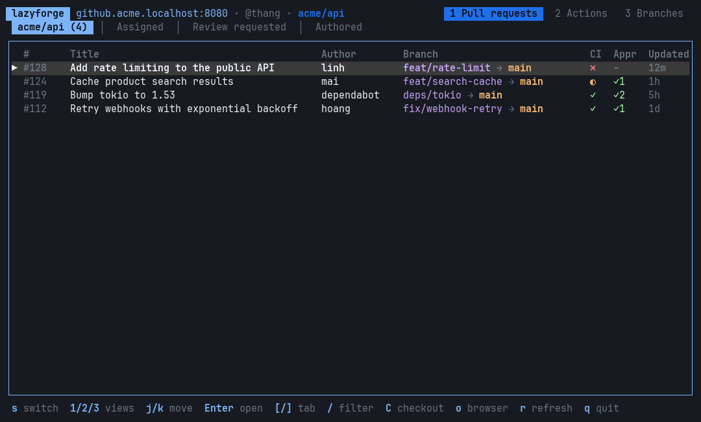

# lazyforge

A terminal UI for GitLab and GitHub (the "forges"), in the spirit of [lazygit](https://github.com/jesseduffield/lazygit): see your merge and pull requests, pipelines and branches, review and approve, and follow CI jobs, without leaving the terminal.

Works with gitlab.com, self-hosted GitLab, github.com and GitHub Enterprise.

> **Status:** early development. Expect rough edges; see [ROADMAP.md](ROADMAP.md) for what's coming.



<sub>The demo runs against a fake server with made-up data ([scripts/demo](scripts/demo)).</sub>

## Features

- **Merge / pull requests**: the ones assigned to you, waiting for your review, written by you, or open in one repository, with CI status, approvals and `source → target` branches.
- **Review**: description, changed files with their diff, discussions and review threads; approve, comment and merge from the keyboard.
- **CI**: GitLab pipelines and GitHub Actions runs, their jobs and logs (live while a GitLab job runs); retry and cancel.
- **Branches**: a repository's branches with their last commit, CI and open merge request; compare any branch with the default branch or another one.
- **Several accounts**: switch platform, account and repository from inside the app (`s`). Tokens are kept in the OS keychain.
- Keyboard first, vim-style keys, and the mouse works too.

How it compares: [lazygit](https://github.com/jesseduffield/lazygit) works on your local repository; lazyforge works on the server side (merge requests, CI, remote branches). [glab](https://gitlab.com/gitlab-org/cli) and [gh](https://cli.github.com) are command-line tools; [gh-dash](https://github.com/dlvhdr/gh-dash) is a dashboard for GitHub only. lazyforge is one interactive screen for both GitLab and GitHub.

## Install

Download the archive for your system from [Releases](https://github.com/thangnd-opensource/lazyforge/releases) (Linux x86_64 and ARM64, macOS Apple Silicon and Intel, Windows), check it against its `.sha256` file, and put `lazyforge` somewhere on your `PATH`. The macOS binaries are not signed yet: if macOS refuses to open it, run `xattr -d com.apple.quarantine lazyforge` once.

Or build it with Rust 1.89 or newer:

```sh
cargo install --git https://github.com/thangnd-opensource/lazyforge
```

Diffs are syntax highlighted (with your terminal's colors). For a smaller binary without it, add `--no-default-features`.

Or from a local checkout: `cargo install --path .`

## Quick start

```sh
lazyforge auth login    # asks GitLab or GitHub, helps you get a token, saves it
lazyforge
```

The first time, lazyforge asks which platform, account and repository to open (or "all my repositories"). After that it reopens the last choice, shown in the header. Press `s` to switch, or start with `lazyforge --pick`.

## Logging in

### GitLab

`lazyforge auth login` opens GitLab's "new personal access token" page with the name and the `api` scope filled in, checks the token you paste, and saves it. `read_api` is enough to browse; approving, commenting, merging and retrying jobs need `api`.

```sh
lazyforge auth login --host gitlab.example.com --profile work   # a self-hosted server, or a second account
```

Without logging in, lazyforge also reads `GITLAB_TOKEN` (and `GITLAB_HOST` for a self-hosted server), handy in scripts.

### GitHub

```sh
lazyforge auth login --kind github                             # github.com: log in through the browser
lazyforge auth login --kind github --with-token                # paste a personal access token instead
lazyforge auth login --from-gh                                 # reuse the GitHub CLI's login
lazyforge auth login --kind github --host github.example.com   # GitHub Enterprise Server
```

Logging in through the browser uses GitHub's device flow: lazyforge shows a code, you enter it at github.com/login/device and authorize. A GitHub Enterprise server needs its own OAuth App: register one with "Enable Device Flow" checked and pass its client id in `LAZYFORGE_GITHUB_CLIENT_ID` (without it, lazyforge asks for a personal access token). A personal access token needs the `repo` scope (`workflow` and `read:org` too, for Actions and organization repositories). SSH keys cannot be used: they only work for `git` itself, not for GitHub's API.

### Where the token is saved

| | `--store keychain` (default) | `--store file` |
|---|---|---|
| Location | macOS Keychain, Windows Credential Manager or Secret Service on Linux | `credentials.toml` next to the config file, mode 600 |
| Security | Encrypted by the OS | Plain text, protected by file permissions (like `glab`) |
| Prompts | macOS asks for permission again after each upgrade (the binary is not signed yet; when building from source, see [CONTRIBUTING.md](CONTRIBUTING.md)) | Never |

The config file only gets the server address, never the token. Running `auth login` again lets you press Enter to keep the saved token, for example to move it from the keychain to a file.

```sh
lazyforge auth status                    # which profiles work, and where their token comes from
lazyforge auth logout --profile work     # remove a saved token
```

## Using it

The header shows the server, your account and the repository; on the right, the three views: `1` merge/pull requests, `2` pipelines (GitHub: Actions), `3` branches. The bottom line always lists the keys that work on the current screen.

Common keys: `j`/`k` (or the arrows) move, `g`/`G` jump to the first/last item of a list, `[`/`]` (or `Tab`/`Shift+Tab`) switch tabs or sections, `/` filters a list, `Enter` opens, `o` opens the current item in the browser, `r` reloads, `C` checks out locally, `Esc` goes back, `s` switches account or repository, `q` quits. `Esc` never quits.

### 1 · Merge / pull requests

Tabs: the chosen repository (when there is one), **Assigned**, **Review requested** and **Authored** (across all repositories).

| Column | |
|---|---|
| CI | Latest pipeline or checks: `✓` passed, `✗` failed, `◐` running, `○` pending, `⏸` manual, `⊘` canceled or skipped, `–` none |
| Appr | How many people approved |
| Branch | `source → target`; a target such as `main`, `master` or `production` is highlighted |

`/` filters by title, author, project, source or target branch, or number (`!42`, `#42`). `Enter` opens the merge request:

| Key | Action |
|---|---|
| `[` / `]` | Section: Overview, Files, Discussion, Pipelines (Actions) |
| `j` / `k` | Files: next / previous file. Elsewhere: scroll |
| `Enter` / `l` / `→` | Files: move the focus to the diff (its border turns green); `j` / `k` then move a line cursor |
| `h` / `←` / `Esc` | Files: back to the file list |
| `J` / `K`, `Ctrl+d` / `Ctrl+u`, `Space` | Scroll the diff or text |
| `a` | Approve, or remove your approval (GitLab only: on GitHub, dismiss your review on the web) |
| `Ctrl+D` (in the comment editor) | Keep a line comment as a review draft instead of sending it; `c` on its line edits it, `d` deletes it |
| `R` | Finish the review: a summary, a verdict (`Tab`: Comment, Approve, Request changes on GitHub), and `Ctrl+S` sends it with all its drafts at once |
| `c` | Write a comment: `Ctrl+S` sends it, `Esc` closes and keeps the draft. In the diff, the comment goes on the line under the cursor (added, removed or unchanged), or replies to the thread already on that line |
| `m` | Merge, after a confirmation (`y`) |

A review sends its line comments together, so the author gets one notification instead of one per comment: on GitHub a single review with its verdict, on GitLab draft notes published at once (then the approval). Drafts stay in lazyforge, per merge request, until the review is sent; quitting with unsent drafts asks first. GitLab's free tier has no "request changes".

Threads on diff lines appear right below their line, with a yellow bar. Comments on lines that are no longer in the diff (the branch changed since) are listed under Discussion only.

Merging sends the commit you were looking at, so the server refuses the merge if someone pushed in the meantime. On GitHub, lazyforge picks a merge method the repository allows.

### CI: the Pipelines section and view `2`

The Pipelines section of a merge request shows its latest pipeline (on GitHub, the workflow runs of its latest commit). View `2` lists recent pipelines in tabs: the chosen repository's (when there is one), then **Mine** (triggered by you) and **Recent**, across your most recently active repositories. `Enter` opens one.

| Key | Action |
|---|---|
| `j` / `k` | Next / previous job |
| `Enter` | Show the job's log (GitLab: it updates every 2 seconds while the job runs) |
| `J` / `K`, `Ctrl+d` / `Ctrl+u` | Scroll the log (scrolling up stops following) |
| `g` / `G` | Top of the log / bottom, and follow it again |
| `f` | Follow on/off |
| `R` / `C` | Retry / cancel the selected job (cancel asks first) |
| `Ctrl+R` / `X` | Retry the failed jobs / cancel the whole pipeline (cancel asks first) |
| `P` / `p` | Older / newer pipeline (GitHub: workflow) of the merge request |

A running pipeline is reloaded every 5 seconds while it is on screen. Jobs and logs come from the project the pipeline ran in, so merge requests from forks work too.

On GitHub, because of its API: a job's log is available once the job has finished (it loads by itself when it does); single jobs cannot be canceled, only whole runs (`X`).

### 3 · Branches

The branches of the chosen repository (pick one with `s`): the default branch first, then the most recently updated, with the last commit, its author, CI status, and the open merge request from the branch.

| Key | Action |
|---|---|
| `Enter` | Compare the branch with the default branch |
| `b` | Compare it with a branch you choose: type to filter, `↑`/`↓`, `Enter` |
| `/` | Filter by branch name, commit title or author |

Comparing shows what the branch changed since it left the other branch (like `git diff main...feature`): the number of commits and the changed files, in the same file list and diff viewer as a merge request. `b` picks another branch to compare with. This screen only reads.

### Checking out locally

Start lazyforge inside a clone of the repository (`cd ~/code/api && lazyforge`), then press `C` on a merge request, a pull request or a branch: after a confirmation, it fetches it and switches to it, so you can run and test the code. `e` then opens the repository in `$VISUAL` / `$EDITOR` (lazyforge steps aside for a terminal editor and comes back when it exits).

- The clone is recognized by its remotes: one of them must point at the repository on screen.
- A merge request uses its branch when that branch is in this repository and holds exactly the merge request's code; otherwise (a fork) it goes to a branch of its own, `mr/42` (GitLab) or `pr/42` (GitHub).
- Your work is never touched: with uncommitted changes to tracked files, nothing happens. lazyforge never resets or forces; a local branch that already exists is only fast-forwarded, and left as it is if it has commits of its own.
- In the Pipelines section, `C` still cancels the selected job.

### Mouse

The wheel scrolls the pane under the pointer: over a diff or a log it scrolls the text, over a list it moves the selection. Clicking a file picks it; clicking a diff gives it the focus. Because lazyforge receives the mouse, selecting text to copy needs a modifier: hold `Option` while dragging in macOS terminals, or `Shift` in most Linux terminals.

## Configuration

`lazyforge auth login` writes the config for you. To edit it by hand: `~/.config/lazyforge/config.toml` (or `$XDG_CONFIG_HOME/lazyforge/config.toml`).

```toml
default_profile = "work"
refresh_interval = 120          # seconds between automatic refreshes of the visible list; 0 turns it off

[profiles.work]
host = "https://gitlab.example.com"
token_env = "GITLAB_WORK_TOKEN" # read the token from this environment variable

[profiles.github]
host = "https://github.com"     # the platform is guessed from the host; set `kind = "github"` if it can't be
```

See [config.example.toml](config.example.toml) for all options. For each profile, the token comes from `token_env`, then `token`, then the one saved by `auth login` (credentials file, then keychain), then `GITLAB_TOKEN`.

| Option | |
|---|---|
| `--profile <NAME>` | Use this profile |
| `--config <PATH>` | Use another config file |
| `--pick` | Open the platform → account → repository picker instead of the last choice |
| `--project <PATH>` | Open this repository, e.g. `group/project` or `owner/repo` |
| `LAZYFORGE_LOG` | Log level, e.g. `debug`, which logs the status of each request (and the URL of REST requests), never tokens |

The log is `~/.local/state/lazyforge/lazyforge.log` (or under `$XDG_STATE_HOME`); the last choice of account and repository is saved next to it.

lazyforge used to be called **lazygl**. On first start it moves `~/.config/lazygl` and `~/.local/state/lazygl` to their new names, and tokens saved in the keychain under `lazygl` to `lazyforge`.

## Development

See [CONTRIBUTING.md](CONTRIBUTING.md), including how to stop the macOS keychain from asking for permission after every build.

```sh
cargo run -- auth login   # once
cargo run
cargo test
cargo clippy --all-targets -- -D warnings
```

The CI runs formatting, clippy, the tests on Linux, macOS and Windows, and a build with the oldest supported Rust.

The code is split in layers:

- `src/forge/`: what GitLab and GitHub have in common: the models the app works with (merge requests, pipelines, branches…), `enum Forge` that dispatches to a backend, a unified diff parser.
- `src/gitlab/`, `src/github/`: the two API clients (GraphQL for lists, REST for details and actions). No UI code, so they can be reused by other tools.
- `src/app/`: application state and an Elm-style reducer (`update(state, action) -> Option<Command>`). No I/O, so it is unit tested without a terminal or a network.
- `src/ui/`: draws the state with [ratatui](https://ratatui.rs).

`src/runtime.rs` ties them together: it waits for keys, the mouse and network results, runs commands in background tasks, and redraws, so the UI never blocks on the network.

## License

[MIT](LICENSE)
